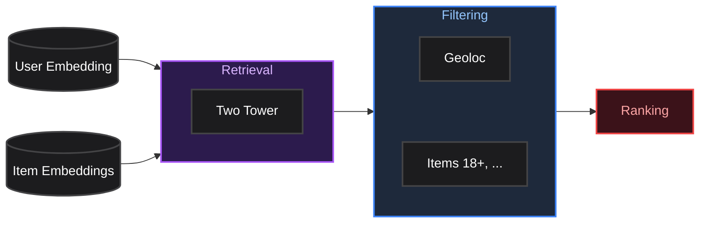
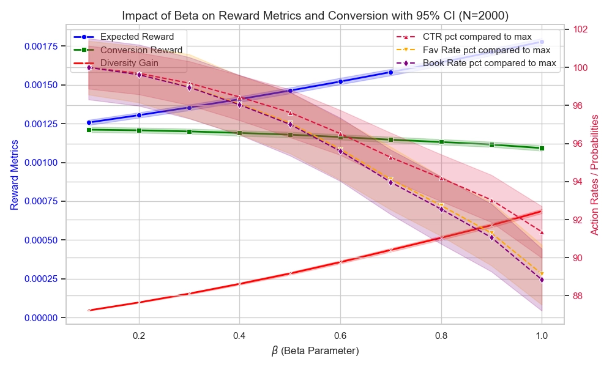

# Installation

- Clone `bandit-demo`, 
- `cd bandit-demo`,
- `uv sync`,
- `source .venv/bin/activate`,
- `gcloud auth application-default login`

Ensuite, ouvrez un fichier python ou un notebook et executez :

```python
from src.datasets.factory import get_dataset

pg_dataset = get_dataset("playground_dataset") # < 1 min
tt_dataset = get_dataset("tt_based_dataset") # ~ 6 min
```

Ces deux lignes exécutent toutes les requêtes SQL nécessaires pour avoir l’entièreté des données. `tt_dataset = get_dataset("tt_based_dataset")` Créée aussi une table `lance_db` pour le retrieval, et récupère des données dans un bucket pour fitter le modèle oracle qui associe une probabilité de conversion à un score du Two Tower. Cette dernière tache peut prendre plusieurs minutes.

You're ready to go !

# App


Le Pass compte parmi ses objectifs celui d’augmenter la diversité des pratiques culturelles. Les algorithmes de recommandation actuels ne vont pas dans le sens de cet objectif, puisqu’ils ont pour objectif de proposer des offres fortement en lien avec les gouts déjà exprimés par l’utilisateur. 
Des travaux précédents sur le DPP ont permis de montrer qu’il est possible d’augmenter la diversité des pratiques culturelles par le moyen des algorithmes de recommandation, mais sans parvenir à maintenir des niveau d’attractivité satisfaisants.

Nous nous fixons pour objectif la mise en place d’un système de recommandations qui permette un gain significatif sur la diversité des pratiques culturelles, tout en maintenant un niveau acceptable de conversion sur les offres recommandées. Le but ici est d'explorer les cas d'utilisation d'algorithmes de bandit pour atteindre cet objectif.

## Objectifs

1. **Explorer les cas d’usages d’algorithmes de Bandit dans les systèmes de recommandation.**

<table border="0" style="width: 100%; border-collapse: collapse;">
<tr>
<td style="vertical-align: top; width: 45%;">

- Quelle place cet algorithme occuperait-il dans notre système ?
- Quel type d’algorithme de bandit est le plus adapté à notre data ?
- Quelle serait son Action Space ? Ses outputs ?

2. **Augmenter la diversité des pratiques culturelles des utilisateurs, tout en maintenant un bon taux de conversion.**
    
    Le score de diversité est caractérisé par :
    
    > Pour chaque réservation, les caractéristiques de diversité observées rapportent des points différents.
    > - nouvelle catégorie d’offre : 25 points
    > - nouvelle sous-catégorie d’offre : 10 points
    > - nouveau type de lieu : 20 points

</td>
<td style="vertical-align: top; width: 55%;">

Système de recommandation actuel : 



</td>
</tr>
</table>

<br>

# **Training Pipeline**

**Cette app s’oriente autour de l’implementation de plusieurs algorithmes de bandit dans un cadre similaire à celui de la recommandation pour le pass culture, et de l’évaluation de ces bandits via l’Offline training, afin de pouvoir déterminer la pertinence de ces algorithmes pour le pass sans faire subir de pertes de performances aux utilisateurs.**

Elle permet de tester et évaluer le algorithmes suivants :
* **Random** Bandit
* **$\epsilon$-greedy** Bandit
* **Decaying $\epsilon$-greedy** Bandit
* **LinUCB** (Linear Upper Confidence Bound)
* **LinTS** (Linear Thompson Sampling)
* **GP-TS** (Gaussian Process Thompson Sampling) avec rolling window
* **Sparse GP-TS** Gaussian Process Thompson Sampling avec Inducing points déterminés dynamiquement via une approximation greedy d'un DPP

> Ces algorithmes et leur formulation sont disponibles en detail dans le document [BANDITS.md](src/models/bandits/BANDITS.md).

```mermaid
graph LR
    %% --- Nodes Definition ---
    Weibull[Weibull]
    DataGen[Data generation]
    PGData[Playground Dataset]
    Dataset[Training Dataset]
    TTData[TT Based Dataset]
    Embeddings[Embeddings]
    TTScore[Oracle pour la conversion]

    NoContext[No context]
    Context[Context]
    MABNoContext[MAB without context]
    ContextMAB[Context MAB]
    Bandit[Bandit Type]

    ArmSelection[Arm selection]
    Retrieval[Retrieval]
    Recommendation[recommendation]
    Outcome[outcome]
    RewardEval[reward evaluation]
    Feedback[Feedback]

    inv1[ ]:::invisible
    inv2[ ]:::invisible

    %% --- Connections ---
    %% [Indices 0, 1, 2] Purple Inputs
    Weibull --> PGData
    DataGen --> PGData
    PGData --> Dataset

    %% [Indices 3, 4, 5] Green Inputs
    Embeddings --> TTData
    TTScore --> TTData
    TTData --> Dataset

    %% [Indices 6 - 12] Bandits
    Dataset --> NoContext
    Dataset --> Context
    NoContext --> MABNoContext
    Context --> ContextMAB
    MABNoContext --> ArmSelection
    ContextMAB --> ArmSelection
    ArmSelection <--> Bandit

    %% [Indices 13-15] Retrieval Loop
    ArmSelection --> Recommendation
    ArmSelection --> Retrieval
    Retrieval --> Recommendation

    %% [Indices 16, 17] Post-Rec Flow
    Recommendation --> Outcome
    Outcome --> RewardEval

    %% [Indices 18 - 22] Blue Feedback Loop
    RewardEval --> Feedback
    Bandit <--> Feedback
    inv1 ~~~ TTData
    TTData ~~~ inv1
    TTData ~~~ inv1
    inv1 ~~~ Bandit
    Bandit ~~~ Feedback


    %% --- Node Coloring & Styling ---
    classDef purple fill:#2c1b4d,stroke:#a855f7,stroke-width:2px,color:#d8b4fe;
    classDef green fill:#143424,stroke:#22c55e,stroke-width:2px,color:#86efac;
    classDef blue fill:#1e293b,stroke:#3b82f6,stroke-width:2px,color:#93c5fd;
    classDef defaultNode fill:#1c1c1e,stroke:#444446,stroke-width:2px,color:#ffffff;
    classDef invisible fill:none,stroke:none,color:none;

    class Weibull,DataGen,PGData purple;
    class Embeddings,TTScore,TTData,Retrieval green;
    class Feedback blue;
    class Dataset,NoContext,Context,MABNoContext,ContextMAB,ArmSelection,Recommendation,Outcome,RewardEval,Bandit defaultNode;

    %% --- Arrow Coloring & Styling ---
    %% Purple Arrows (Indices 0, 1, 2)
    linkStyle 0,1,2,13 stroke:#a855f7,stroke-width:2px;

    %% Green Arrows (Indices 3, 4, 5 to Dataset; 13, 14 for Retrieval)
    linkStyle 3,4,5,14,15 stroke:#22c55e,stroke-width:2px;

    %% Blue Feedback Arrows (Indices 17, 18)
    linkStyle 18,19 stroke:#3b82f6,stroke-width:2px;
```




<br>

**Pour cela, deux datasets ont été implémentés :**

> Plus de details sur les datasets [ici](src/datasets/DATASETS.md).

# Playground Dataset

Ce dataset permet de générer des profils utilisateurs similaires à ceux que l’ont peut trouver chez les utilisateurs du pass culture. La donnée est entièrement fictive, et on peux jouer avec les probabilités de conversion voulues au moment de la generation de la donnée.

Le context fourni aux bandits est un embedding simple des historiques utilisateurs générés. Ces historiques sont en accord avec les habitudes des utilisateurs du pass sur la diversité de catégories dans l’historique, et sur lesquelles de ces catégories sont les plus populaires.

# TT Based Dataset (Oracle)

Ce dataset, bien plus complet, permet d’entrainer les bandits sur de vrais profils utilisateurs. 

Le context est un embedding utilisateur, habituellement fourni au Two Tower actuellement utilisé pour la recommandation au pass culture.

Pour être au plus proche de la réalité, ce dataset se base sur un modèle oracle pour évaluer la conversion suite à une recommandation (et donc le reward qui en découle).


## Modèle Oracle

Pour simuler le fonctionnement du bandit en Offline, il nous faut un modèle des comportements utilisateurs.

Concrètement, pour chaque context possible et chaque choix d'action (c'est-à-dire choix de bras) possible, on veut pouvoir estimer une probabilité de conversion (probabilité d’un clic, d’une mise en favoris et d’une réservation). Pour faire cette estimation, s’appuie sur le **Two Tower**. 

On s'intéresse aux logs de recommendations dont on dispose, au score associé à chaque recommandation et aux interactions utilisateurs qui en ont découlé. 

On fit nos données sur des fonctions adaptées, et on obtient de courbes d'approximation des probabilités de conversion pour chaque événement de conversion (clic, mise en favoris, reservation) en fonction du score associé à la distance entre un embedding utilisateur et un embedding d'item.

<div style="display: flex; justify-content: center;">
  
</div><br>

On a maintenant des fonctions nous permettant de lier une distance entre un embedding utilisateur et un embedding item à des probabilités de conversion.

On l’utilise pour l’offline training, qui suit le processus suivant :

<div style="border: 1px solid #ccc; padding: 10px; border-radius: 5px;">

## Training Steps

**Pour la phase d’évaluation des bandits, on se contente de recommander un unique item, pour simplifier.**

### À chaque itération, le training suit les étapes suivantes :


**Pour un utilisateur $u$ à une étape $t$ donnée :**

### Étape 1 : Définition du contexte

L’utilisateur $u$ est caractérisé par deux éléments :

- Un vecteur d’embedding $\mathbf{x}_u \in \mathbb{R}^d$
- Un historique d’interactions $h_u$, contenant les métadonnées avec lesquelles il a déjà interagi : $h_u = \{C_u, S_u, V_u\}$ (catégories, sous-catégories, types de lieux).

### Étape 2 : L’Espace d’Action et le Filtrage (Le choix du Bras)

Le bandit choisit un bras $a = (\text{cat}_a, \text{sub}_a, \text{vt}_a)$ parmi l’ensemble des bras possibles $\mathcal{A}$, restreignant le catalogue total d’items $\mathcal{I}$ à un sous-ensemble d’items éligibles $\mathcal{I}_a \subset \mathcal{I}$ :

$$
\mathcal{I}_a = \{i \in \mathcal{I} \mid \text{cat}_i = \text{cat}_a \land \text{sub}_i = \text{sub}_a \land \text{vt}_i = \text{vt}_a\}
$$

### Étape 3 : La Sélection de l’Item par le Système (Retrieval)

On effectue une recherche du plus proche voisin (Top-1) dans la table LanceDB en utilisant la métrique du produit scalaire (dot product). L’item sélectionné $i^*$ est celui qui minimise la distance géométrique $\text{dist}(\mathbf{x}_u, \mathbf{y}_i)$ avec l’embedding de l’utilisateur pour le sous ensemble $\mathcal{I}_a$ :

$$
i^*(a, u) = \arg\min_{i \in \mathcal{I}_a} \text{dist}(\mathbf{x}_u, \mathbf{y}_i)
$$

### Étape 4 : L’Évaluation des Probabilités de Conversion

Soit $x = \text{dist}(\mathbf{x}_u, \mathbf{y}_{i^*(a, u)})$. Les probabilités intrinsèques de chaque événement sont calculées via des fonctions exponentielles $f_e(x)$ (où $e \in \{\text{click}, \text{faved}, \text{booked}\}$) :

$$
f_e(x) = f(x; k_e, \alpha_e, \beta_e) = k_e \cdot e^{-\alpha_e x} + \beta_e
$$

On tient compte du `boost` et de la condition de cascade (pas de favori ni de réservation sans clic), les probabilités réelles (espérances) d’activation de chaque événement pour le bras $a$ sont :

- **Clics :** $P(\text{clicked} \mid u, a) = \min\left(1, \text{boost} \cdot f_{\text{clicked}}(x)\right)$
- **Favoris :** $P(\text{faved} \mid u, a) = \min\left(1, \text{boost} \cdot f_{\text{faved}}(x)\right)$
- **Réservations :** $P(\text{booked} \mid u, a) = \min\left(1, \text{boost} \cdot f_{\text{booked}}(x)\right)$

> ### Très faible fréquence de reward non nul
> ---
> 
> Dans les logs, on considère chaque offre dans chaque playlist comme une recommandation, et chaque appel à l’API déclenche la génération d’une playlist.
> 
> Les probabilités de conversion sont donc extrêmement faibles, et même pour un bras optimal le bandit aura généralement un reward nul. Les bandits ne parviennent pas à apprendre dans une donnée aussi faiblement peuplée. Pour pallier à ça en Offline, on introduit un paramètre de `boost`, qui intervient comme suit : 
> 
> - **Clics :** $P(\text{clicked} \mid u, a) = \min\left(1, \text{boost} \cdot f_{\text{clicked}}(x)\right)$
> - **Favoris :** $P(\text{faved} \mid u, a) = \min\left(1, \text{boost} \cdot f_{\text{faved}}(x)\right)$
> - **Réservations :** $P(\text{booked} \mid u, a) = \min\left(1, \text{boost} \cdot f_{\text{booked}}(x)\right)$

### Étape 5 : Évaluation de l’Outcome et du Reward

Dans notre environnement de simulation, le reward final est fonction d’une interaction (outcome) binaire (0 ou 1) suite à un tirage de Bernoulli ($X < p$).

Pour chaque événement, on choisi $x_e$ aléatoirement suivant une loi uniforme $\mathcal{U}([0, 1])$, puis $\text{Outcome}_\text{e} = \mathbb{1}_{[0, p_e]}(x_e)$.

On peut alors évaluer le reward

$$
R_{i,u} = Conv(\text{Outcome}_\text{Clic, Faved, Booked}) \cdot (1 + \beta \cdot Div(H_u, i))
$$

### Étape 6 : Update du Bandit

On informe le bandit du reward obtenu, pour qu’il puisse mettre à jour son modèle interne.

</div>

<br>

<div style="border: 1px solid #ccc; padding: 10px; border-radius: 5px;">


# Definition du Reward 

On note $R_{p,u}$ le reward pour un item $i$ recommandé à un utilisateur $U$ ayant un historique $H_u$.

On définit alors le reward :

$$
R_{i,u} = Conv(u, i) \cdot (1 + \beta \cdot Div(H_u, i))
$$

Où :

- $\beta$ est un **paramètre de pondération** pour l’importance de la diversité dans le reward.
- $Conv(i)$ est une **mesure de la conversion** de l’item $i$ :
    
    $$
    Conv(u, i) = \frac {\omega_1 \cdot \mathbb{1}_{clic}(u, i) + \omega_2 \cdot \mathbb{1}_{favoris}(u, i) + \omega_3 \cdot \mathbb{1}_{resa}(u, i)}{\omega_1 + \omega_2 + \omega_3}
    $$
    
- $Div(H_u, i)$ est une **mesure de la diversité** de l’item $i$ par rapport à l’historique $H_u$ :
    
    $$
    Div(H_u, i) = \frac{1}{55} \cdot div\_score(H_u, i)
    $$
    
    ---
    
    > Le **score de diversité** est calculé comme suit :
    > Pour un utilisateur et un item, les caractéristiques de diversité observées rapportent des points différents.
    > 
    > - nouvelle catégorie d’offre : 25 points
    > - nouvelle sous-catégorie d’offre : 10 points
    > - nouveau type de lieu : 20 points
    
    Chaque utilisateur commence à 0. Une première réservation permet de gagner des points dans chacune des caractéristiques : elle rapporte donc 55 points.
    

⚠️ **Le score de diversité calculé ici est valable pour une paire utilisateur item, quelle que soit l’interaction** (clic ou non, …) contrairement à la métrique de diversité du pass qui n’augmente que pour un booking.

### Playlists :

Dans les cas des playlists, on devra tenir compte du rang dans la playlist. Le reward devient alors :

Pour $R_{p,u}$ le reward pour une playlist $P$ recommandée à un utilisateur $U$ ayant un historique $H_u$,
Pour $i \in P$ un item recommandé, on note $r_i$ le rang de $i$ dans $P$.

On a  :

$$
R_{p,u} = \sum_{i \in P} \gamma^{r_i} \cdot Conv(u, i) \cdot (1 + \lambda \cdot Div(H_u, i))
$$

Où $\gamma$ est un **facteur de décroissance** pour les items recommandés plus bas dans la playlist ($\gamma < 1$)


</div>

## Trade Off Conversion - Diversité : Borne Inférieure de la Perte en Conversion


Dans notre environnement de simulation, le reward final est fonction d’une interaction (outcome) binaire (0 ou 1) suite à un tirage de Bernoulli ($X < p$). Si on évalue le bandit optimal sur le reward *réel* obtenu, les métriques sont extrêmement bruitées à court terme à cause de la variance de ce tirage.

On souhaite mesurer la performance non pas sur le tirage au sort, mais directement sur **l’espérance mathématique** $\mathbb{E}[R]$ des gains.

Pour un utilisateur $u$  et un bras $a$, les probabilités réelles (espérances) d’activation de chaque événement sont :

- **Clics :** $P(\text{clicked} \mid u, a) = f_{\text{clicked}}(x)$
- **Favoris :** $P(\text{faved} \mid u, a) =  f_{\text{faved}}(x)$
- **Réservations :** $P(\text{booked} \mid u, a) = f_{\text{booked}}(x)$

L’espérance de la récompense de conversion pure, $\mathbb{E}[R_{\text{conv}}(u, a)]$, est la somme pondérée de ces probabilités par leurs poids respectifs $\omega$ :

$$
\mathbb{E}[R_{\text{conv}}(u, a)] = \frac{\omega_1 \cdot P(\text{clicked} \mid u, a) + \omega_2 \cdot P(\text{faved} \mid u, a) + \omega_3 \cdot P(\text{booked} \mid u, a)}{\omega_1 + \omega_2 + \omega_3}
$$

En y injectant le multiplicateur de diversité $D(h_u, a)$, la récompense maximale attendue $\mu^*(u)$ par l’Oracle pour un utilisateur $u$ est :

$$
\mu^*(u) = \max_{a \in \mathcal{A}} \left( \mathbb{E}[R_{\text{conv}}(u, a)] \cdot \Big(1 + \beta \cdot D(h_u, a)\Big) \right)
$$

Dans ce cas, **le bras qui maximise la conversion n’est plus nécessairement le bras optimal**. Un bras offrant une probabilité de conversion légèrement plus faible mais apportant une forte diversité exclusive (car ses labels ne sont pas dans $h_u$) peut générer une espérance supérieure.

## Pour un échantillon de 2000 utilisateurs :

<div style="display: flex; justify-content: center;">
  
</div><br>

⚠️ Il s’agit ici d’une borne inférieure en terme de pertes de conversion, atteindre cette borne avec les bandits est très compliqué !


# Next Steps

Pour implementer le bandit en prod, on souhaite construire le système suivant : 

### Positionnement du Bandit :


On voudra alors porter une attention particulière aux points suivants : 

<div style="border: 1px solid #9f9f9f; padding: 10px; border-radius: 5px;">

## Context Shaping

Quelle est la donnée nécessaire et suffisante à inclure dans le contexte pour avoir des résultats satisfaisants ?

Quelle est la donnée optimale pour que le bandit interprète au mieux le contexte ?

---

Dans un premier temps, on s’est contenté de fournir au bandit les embeddings utilisateurs tels que dans le Two Tower, de dimension 64.

Ce context peut être adapté. On peut par exemple y ajouter un embedding en trois dimensions de l’historique utilisateur, avec les categories dans une dimension, les sous catégories dans une autre et enfin les venue type.

### Process

---

Voir la partie `tt_based_dataset` du `analysis.ipynb` pour un exemple d’utilisation du système décrit ci dessous.

Pour un `bandit` dont l’Offline training se base sur le dataset `tt_based_dataset`, on spécifie au moment du training `context="user_embedding"`, c’est à dire qu’on dit au bandit d’utiliser comme input cette colonne du `training_dataset`, qui correspond a un subset du dataset `user_data`.

Pour tester un nouveau type de contexte :

1. On enrichit donc `user_data` avec une colonne `context` contenant le context voulu
2. On spécifie `dataset.training_data = dataset.user_data.head(n)`
3. On entraine le bandit et on compare les résultats avec la version précédente du contexte

</div>

<br>

<div style="border: 1px solid #9f9f9f; padding: 10px; border-radius: 5px;">

## Definition de l’Action Space : Choix des clusters

L’Action space est actuellement l’ensemble des triplets (catégorie, sous catégorie, venue type) associés à au moins une offre active. Si ces bras permettent d’avoir de bon résultats (car il impliquent un control total sur la diversité), ils peuvent être améliorés.

En particulier, pour les bras très peuplés (par exemple Livre/…/Librairie), on peut vouloir ajouter une 4e dimension “thématique”, possiblement en utilisant les GTLs.

</div>

<br>

<div style="border: 1px solid #9f9f9f; padding: 10px; border-radius: 5px;">

## Feedback des playlists

## Décomposition Bras par Bras

On attribue a chaque bras le reward correspondant aux offres qui lui appartiennent

→ Certains bras n’ont pas de reward (pas dans la playlist finale), ce qui peut être different d’un reward nul ⚠️ Choisir si on veut un reward nul (on considère que le bras ne doit pas être recommandé si il ne passe pas l’étape du two tower) ou non.

→ Il faut tenir compte du rang de l’item dans la playlist, et corriger en fonction ! Le 10e item a moins de chance de convertir que le premier

## Formalisation en Combinatorial Multi-Armed Bandit

On considère que le bandit ne sélectionne pas un bras, mais un super bras qui est une combinaison de 10 bras.

Pour des algorithmes comme **LinUCB** ou **LinTS**, la propriété de linéarité de l'espérance nous permet de traiter le feedback en faisant des ****mises à jour indépendantes des matrices de régression pour chacun des bras réellement exposés au feedback.

</div>

<br>

<div style="border: 1px solid #9f9f9f; padding: 10px; border-radius: 5px;">

## Online feedback

Dans le schéma classique, le MAB choisit une action, l’utilisateur interagît, le MAB reçoit une recompense et se met a jour en conséquence.

!image.png

Un MAB est donc capable de répondre a des trends en se mettant à jour continuellement.

En théorie, l'algorithme reçoit la récompense instantanément après avoir choisi l'action. En pratique, entre l'affichage d'une recommandation et la conversion finale (l’achat/la réservation), il peut s'écouler des temps longs, parfois plusieurs semaines.

Si le système ne reçoit rien immédiatement, il peut interpréter l'absence de clic comme un échec (récompense = 0) et arrêter d'explorer un item pourtant prometteur. D’un autre coté, on ne peut pas attendre indéfiniment avant de considérer qu’une recommendation n’a pas portée ses fruits.

La solution est de considerer un delayed feedback.

## La solution simple :

On détermine une fenêtre temporelle maximale pour la conversion, par exemple $x$ heures. Pour chaque recommendation, après $x$ heures, on renvoie le résultat au bandit.

Ou alors;

Tous les jours à un instant $T$, on fourni au bandit tous les résultats des recommandations ayant eu lieu entre $T - x$ heures et $T - (x + 24)$ heures.

## La solution optimisée :


On utilise un modèle basé sur deux variables aléatoires : une pour la conversion et une pour le délai, souvent modélisé par une distribution exponentielle.
Au lieu de punir le modèle si un clic récent n'a pas de conversion, l'algorithme calcule si ce "silence" est normal ou non.

https://dl.acm.org/doi/10.1145/2623330.2623634


https://arxiv.org/abs/1803.10937

https://arxiv.org/abs/2402.03141

https://johaupt.github.io/blog/downsampling_recalibration.html

</div>

<br>

<div style="border: 1px solid #9f9f9f; padding: 10px; border-radius: 5px;">

## IPS

L'[Inverse Propensity Scoring](https://eugeneyan.com/writing/counterfactual-evaluation/#:~:text=However%2C%20IPS%20has,to%20be%20recommended) est très utile pour estimer nos gains liés à l'introduction d'un bandit dans notre pipeline de recommandation.

Le caractère exploratoire du bandit complique considérablement l'évaluation de l'IPS. Cependant, il existe des solutions :  https://dl.acm.org/doi/fullHtml/10.1145/3383313.3412262

</div>