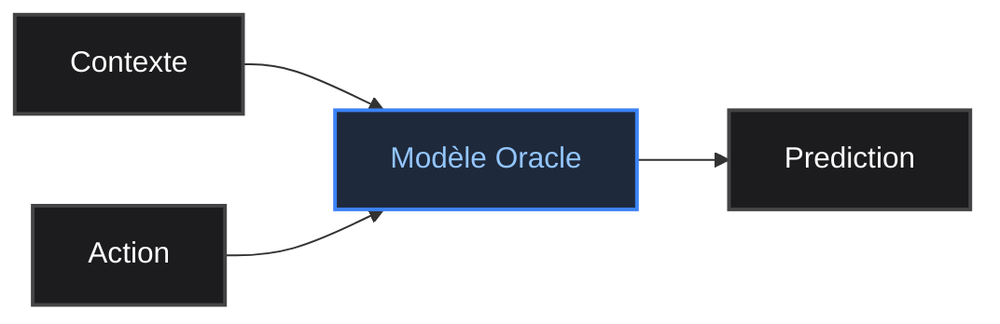
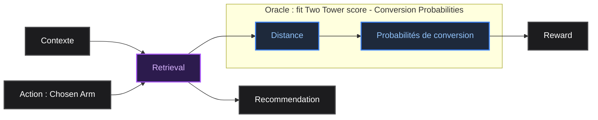

# 1. Playground Dataset : Générer un dataset cohérent

Dans un premier temps, on veut utiliser un dataset sur lequel on a un contrôle complet, et qui nous permettra de tester des conditions limites de nos algorithmes.
On veut un dataset qui reproduit assez fidèlement les caractéristiques du nôtre, mais facile à manipuler. On veut garder certaines spécificités :
- La plupart des utilisateurs connaissent peu de catégories, sous catégories et venue type.
- Certaines catégories, sous catégories et venue type sont plus populaires que d'autres.
- Les utilisateurs ont tendance à continuer à réserver dans les catégories, sous catégories et venue type qu'ils connaissent déjà.

### On construit un dataset avec ```generate_playground_dataset```, où une recommendation est :
- Une offre : Appartient à une playlist proposée à l'utilisateur, à une catégorie, sous catégories et venue type.
- Un utilisateur : Il a un historique qui correspond à ses réservations passées
- Un outcome, c'est-à-dire le résultat de l'interaction entre l'utilisateur et la reco

|Recommended playlist related data|User related data|Conversion related data|
|:---|:---|:---|
|Playlist reco id <br> Offer id <br>Offer category <br>Offer subcategory <br>Offer venue type <br> Offer venue <br> Offer genre <br>Offer rank in the playlist |User id <br> User history, including : <br> Known categories <br> Known subcategories <br> Known venue types <br>Known venues <br>Known genres | <br> was offer clicked <br>was offer favorited <br> was offer booked |

La **conversion**, calculée dans ```get_conversion``` dépend uniquement de l'historique de l'utilisateur et des caractéristiques de l'offre.

## Distribution de Weibull :

Pour que le dataset généré soit cohérent avec nos données réelles, on veut que les historiques de nos utilisateurs factices suivent les mêmes tendances que ceux des vrais utilisateurs. On fait une analyse des quantités de catégories, sous catégories, venue type et venue ids distinct dans l'historique de nos utilisateurs. <br>
On observe que ces 4 grandeurs suivent des **distributions de Weibull** $$\forall x \geq 0,~ f(x;k, \lambda) = \frac{k}{\lambda} \cdot \left (\frac{x}{\lambda}\right)^{k-1} e^{-\left (\frac{x}{\lambda}\right)^{k}}$$
Avec les paramètres $k$ et $\lambda$ qui varient pour chaque grandeur.

Avec ```generate_user_history```;
**La taille de l'historique des utilisateurs** (le nombre de catégories, sous catégories, venue type et venue ids distinct) suit une loi de Weibull discrétisée. <br>

**Le contenu de l'historique des utilisateurs** suit une loi de probabilités caractérisée par le total des réservations dans chaque catégorie, sous catégories et venue type entre le 01/02/2026 et 01/04/2026.


## Training Dataset ```generate_synthetic_training_dataset```

Pour réduire l'action space de nos bandits, on simule des clusters d'offres en associant chaque bras à un triplet (catégorie|sous-catégorie|venue-type). On calcule la conversion en prenant en compte uniquement l'historique de l'utilisateur et ce triplet. <br>
Afin de simuler le processus d'online learning, on s'assure que chaque recommendation possible soit associée à un reward. On a alors un dataset de type :
| User_history | Arm 1 | Arm 2 | ... | Arm x |
|:---:|:---:|:---:|:---:|:---:|
|cats{}, subs{}, loc_types{}| Conversion 1 | Conversion 2 | ... | Conversion x |

<br>

Lors de l'entraînement, le MAB peut utiliser comme contexte l'historique de l'utilisateur, et doit choisir un bras. Il a ensuite à sa disposition la conversion associée au bras qu'il a choisi pour le context donné, directement dans le dataset. L'outcome est associé à un score par le moyen de la fonction de reward, avant d'être converti en feedback pour améliorer notre bandit.

<br>

# 2. TT Based Dataset : S'entraîner sur les logs

### L'**Offline training** sert deux buts : 
- **Le Problème du Bootstrap :** Si on deploie un bandit sans connaissances préalable (initialisation uniforme), il explorera de manière aléatoire dans un premier temps, ce qui aura pour conséquence une expérience utilisateur dégradée.
On veut utiliser les logs historiques (issus de notre précédent système de recommandation) pour initialiser les paramètres du bandit. Au lieu de partir de zéro, le bandit commence avec une « meilleure estimation » de ce que les utilisateurs aiment, entrant ainsi directement dans la phase d'Exploitation tout en affinant ses connaissances grâce à une Exploration contrôlée.

- **L'Evaluation Off-Policy :** C'est notre principale motivation pour l'offline training. On veut pas déployer un bandit sans savoir (ou du moins sans avoir une idée de) la façon dont il va se comporter, ou plus précisément, de la façon dont il se serait comporté s'il avait été déployé.
Puisqu'on ne peut pas « rejouer » l'histoire (on ne peut pas voir ce que l'utilisateur aurait fait si le bandit lui avait présenté un article différent), on doit utiliser des techniques statistiques telles que l'IPS (Inverse Probability Scoring) ou les estimateurs "Doubly Robust". <br>
Pour plus de détail sur ces méthodes, voir [Contextual MAB in recommender systems - Évaluation Hors-Ligne (Off-Policy Evaluation)](https://www.notion.so/passcultureapp/Contextual-MAB-in-recommender-systems-and-adjacent-methods-33bad4e0ff988046afacf3f04cb2d2a1?source=copy_link#34bad4e0ff9880ce8924e1d2a53c759c).

Dans notre cas, on n'a pas suffisamment de données à notre disposition pour s'appuyer sur l'IPS. Pour combler les trous dans la donnée associés à la partie *Exploration* de nos bandits, on va faire appel à la méthode directe : On va exploiter un modèle de régression pour prédire un reward $\hat{r}(x,a)$ pour toute pair (context - action).

Concrètement, on veut :



## Extraction de probabilités de conversion à partir de cosine distance

Concrètement, pour chaque context possible et chaque choix d'action (c'est-à-dire choix de bras) possible, on veut pouvoir estimer une probabilité de conversion (probabilité que la recommendation soit vue, proba qu'elle soit mise en favori et probabilité qu'elle soit réservée). Pour faire cette estimation, on veut si possible s'appuyer sur un modèle déjà existant, afin de ne pas avoir à développer et entraîner un modèle complexe.  <br>
Dans notre cas, un modèle répond à nos attentes : le **Two Tower**. <br>

Dans notre cas, on veut alors :



On s'intéresse aux logs de recommendations dont on dispose, au score associé à chaque reco et aux interactions utilisateurs qui en ont découlé.
Le dataset source a été construit avec les données de `past_offer_context_sink` pour les logs de recommandation et de `reco_offer_conversion` pour les événements de conversion. Il contient les colonnes :
|item_id|offer_id|offer_reco_rank|offer_category|context|user_id|conversion|score|
|:---:|:---:|:---:|:---:|:---:|:---:|:---:|:---:|

<br>

On applique un filtre sur ces données : score <= 1, user_id != "-1", context == "recommendation:user_based", offer_reco_rank < 2
- score <= 1 : Garantit que les cold starts sont exclus.
- user_id != "-1" : Garantit que la route « similar_offer » est exclue.
- context == "recommendation:user_based" : Garantit que les « Top Offres » sont exclues.
- offer_reco_rank < 2 : Ne conserve que les deux premières recommandation de chaque playlist afin de s'assurer que les probabilités de conversion soient calculées sur des recommandations effectivement vues.

<br>

>Il est important de noter pour la suite que le **score** du **Two Tower** est une **distance**, basée sur une métrique de **cosine similarity** évaluée sur des vecteurs **normalisés**.

<br>

On peut maintenant fitter nos données sur des fonctions adaptées. On choisit des exponentielles décroissantes $f(x, k, a, b) = k \cdot e^{-a \cdot x} + b$ (fit pour k, a , b), et on obtient :


## Context et embeddings

On choisit dans un premier temps comme context les embeddings d'utilisateurs réalisés pour le Two Tower, pour rester dans les conditions les plus simples d'estimation de probabilités de conversion. On aura aussi besoin des embeddings d'items pour pouvoir calculer le score qui nous permettra de déterminer ces probabilités.

## Retrieval

Ce module utilise LanceDB pour récupérer les top-k éléments les plus similaires à l'embedding d'un utilisateur.

* ### Fonctionnement

    - Une table LanceDB est ouverte ou créée via `get_lancedb_table()`.
    - La fonction `retrieve_items()` effectue une recherche vectorielle sur la colonne `item_embedding`.
    - La métrique de recherche est explicitement configurée sur `dot` (produit scalaire).

* ### Sémantique de la métrique

    Le code utilise la métrique `dot` dans LanceDB. Elle est traitée comme une métrique de **distance** et non de similarité. Des valeurs de `_distance` plus faibles correspondent à des vecteurs plus similaires. <br>
    Pour des vecteurs normalisés, le *dot product* est équivalent à la *cosine similarity*, et la distance du produit scalaire correspond donc à la distance cosinus.

## Training Dataset

Le MAB récupère un `user_id`, et un `user_embedding` en guise de context. Il choisit un bras, c'est à dire une catégorie d'offre, sous catégorie et venue type, puis envoie au retrieval le `user_embedding` et le bras choisi. <br>
Le retrieval applique des filtres correspondant au bras choisi, puis récupère l'item qui minimise la distance (`item_embedding`, `user_embedding`) parmi tous les items du catalogue qui correspondent au filtre. <br>
Ensuite, on estime les probabilités de conversion de la recommendation grâce à ce score, et on en déduit un outcome qui est associé à un score par le moyen de la fonction de reward, avant d'être converti en feedback pour améliorer notre bandit.

<br>